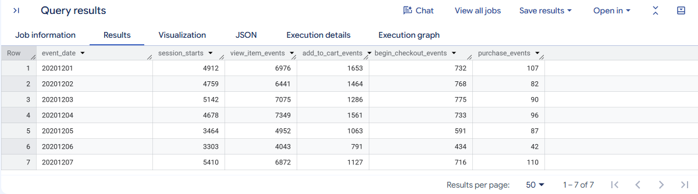
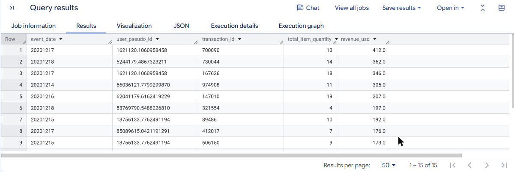
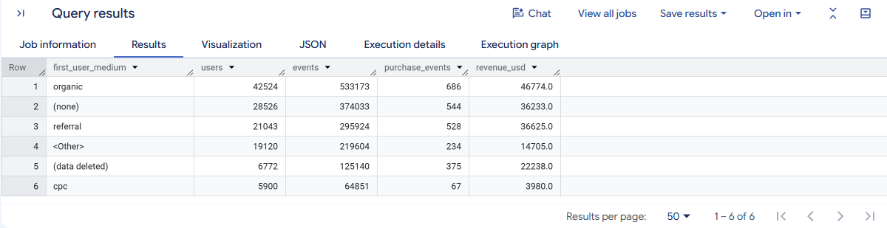
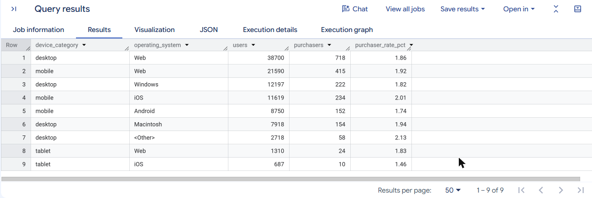
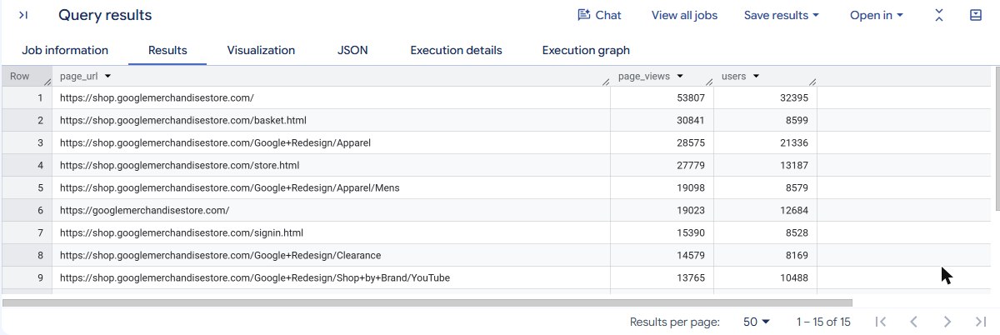
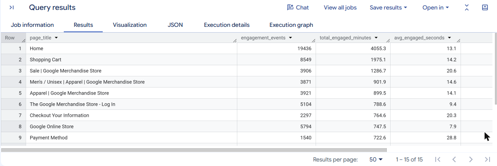
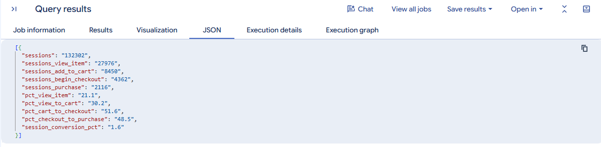
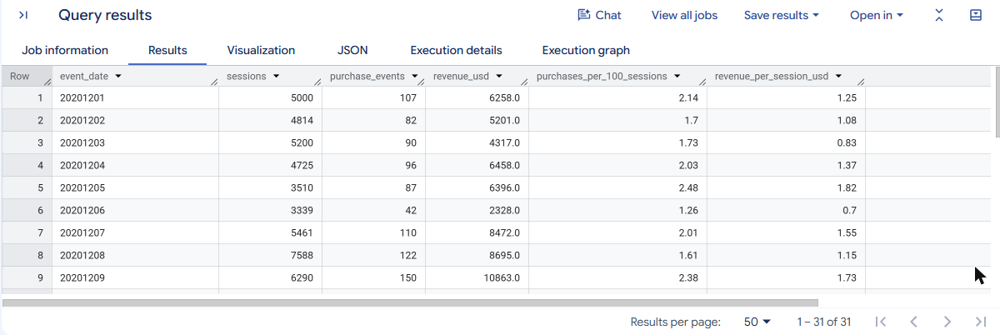

# Overview

This SQL pack shows eight GoogleSQL queries written against GA4 export data in BigQuery. Our team does not have access to CCHM's GA4 property or a BigQuery export yet (see our Milestone 2 QA log), so every query runs on Google's public GA4 sample, `bigquery-public-data.ga4_obfuscated_sample_ecommerce`. It has the same schema as any GA4 export: one table per day (`events_YYYYMMDD`), one row per event, and nested `event_params`, `ecommerce`, `device`, `geo`, and `traffic_source` fields. Once CCHM's export is connected, these queries can be pointed at that dataset by swapping the table name and event names.

Every query was run in my BigQuery sandbox. Each one has the SQL, a screenshot of the output, and a short explanation of what it answers, how it works, when to use it, and a caveat.

## Skill Coverage

| Query | Topic | A. Filter | B. Group | C. UNNEST | D. CTE | E. Join / combine |
|---|---|:---:|:---:|:---:|:---:|:---:|
| Q1 | Daily funnel events for one week | ✓ | ✓ | | | |
| Q2 | Top mobile US purchases | ✓ | | | | |
| Q3 | Users and revenue by first user medium | ✓ | ✓ | | | |
| Q4 | Purchaser rate by device and OS | ✓ | ✓ | | | |
| Q5 | Top pages (`page_location`, string) | ✓ | ✓ | ✓ | | |
| Q6 | Engaged time by page (`engagement_time_msec`, int) | ✓ | ✓ | ✓ | | |
| Q7 | Session level shopping funnel | ✓ | ✓ | ✓ | ✓ | ✓ |
| Q8 | Daily sessions joined to daily revenue | ✓ | ✓ | ✓ | ✓ | ✓ |

## Definitions Used Throughout

To avoid mixing up metrics, these are the definitions used in every query:

-   **Events:** `COUNT(*)` rows. One user action can create several events.
-   **Users:** `COUNT(DISTINCT user_pseudo_id)`. This is a browser or device ID, not a person.
-   **Sessions:** a unique combination of `user_pseudo_id` and the `ga_session_id` event parameter.
-   **Date scoping:** every query filters `_TABLE_SUFFIX` so BigQuery only scans the days needed. The sample covers November 1, 2020 to January 31, 2021, and I used December 2020 (or one week of it) throughout.

# Filtering and Scoping

## Q1: Daily Funnel Events for One Week

```sql
SELECT
  event_date,
  COUNTIF(event_name = 'session_start')  AS session_starts,
  COUNTIF(event_name = 'view_item')      AS view_item_events,
  COUNTIF(event_name = 'add_to_cart')    AS add_to_cart_events,
  COUNTIF(event_name = 'begin_checkout') AS begin_checkout_events,
  COUNTIF(event_name = 'purchase')       AS purchase_events
FROM `bigquery-public-data.ga4_obfuscated_sample_ecommerce.events_*`
WHERE _TABLE_SUFFIX BETWEEN '20201201' AND '20201207'   -- one week only
  AND event_name IN ('session_start', 'view_item', 'add_to_cart',
                     'begin_checkout', 'purchase')
GROUP BY event_date
ORDER BY event_date;
```



-   **This query answers:** how many times each shopping step happened per day during the first week of December 2020.
-   **It works by:** limiting the scan to seven daily tables with `_TABLE_SUFFIX`, keeping only the five funnel events with `IN`, and then using `COUNTIF` to turn each event into its own column, so there is one row per day.
-   **What the output shows:** volume dropped over the weekend. Saturday December 5 and Sunday December 6 had the fewest session starts (3,464 and 3,303), and Sunday had the fewest purchases (42). Monday December 7 bounced back to the highest session starts (5,410) and purchases (110).
-   **You'd use it when:** checking daily health of the funnel, or spotting a tracking break (a day where one event suddenly goes to zero).
-   **Caveat:** these are **event** counts, not users or sessions. One person who views ten products creates ten `view_item` events.

## Q2: Highest Value Mobile Purchases from the US

```sql
SELECT
  event_date,
  user_pseudo_id,
  ecommerce.transaction_id,
  ecommerce.total_item_quantity,
  ecommerce.purchase_revenue_in_usd AS revenue_usd
FROM `bigquery-public-data.ga4_obfuscated_sample_ecommerce.events_*`
WHERE _TABLE_SUFFIX BETWEEN '20201214' AND '20201220'
  AND event_name = 'purchase'
  AND device.category = 'mobile'
  AND geo.country = 'United States'
  AND ecommerce.purchase_revenue_in_usd > 0
ORDER BY revenue_usd DESC
LIMIT 15;
```



-   **This query answers:** what the biggest mobile orders from US shoppers looked like in the week before Christmas.
-   **It works by:** stacking several `WHERE` filters, including filters on nested RECORD fields with dot notation (`device.category`, `geo.country`, `ecommerce.purchase_revenue_in_usd`), and excluding zero revenue rows.
-   **What the output shows:** the largest order was $412 for 13 items on December 17. The same `user_pseudo_id` also appears in third place with a $346 order that same day, so one shopper placed two of the top three orders.
-   **You'd use it when:** pulling a specific segment for a deeper look, like checking high value orders for a campaign report.
-   **Caveat:** this sample is obfuscated, so transaction IDs and revenue are not real store values. In real data I would also check for duplicate `transaction_id` values before summing revenue.

# Grouping and Aggregation

## Q3: Users, Events, and Revenue by First User Medium

```sql
SELECT
  traffic_source.medium                          AS first_user_medium,
  COUNT(DISTINCT user_pseudo_id)                 AS users,
  COUNT(*)                                       AS events,
  COUNTIF(event_name = 'purchase')               AS purchase_events,
  ROUND(SUM(ecommerce.purchase_revenue_in_usd), 2) AS revenue_usd
FROM `bigquery-public-data.ga4_obfuscated_sample_ecommerce.events_*`
WHERE _TABLE_SUFFIX BETWEEN '20201201' AND '20201231'
GROUP BY first_user_medium
ORDER BY users DESC;
```



-   **This query answers:** which acquisition medium brought in the most users and revenue in December 2020.
-   **It works by:** grouping every December event by `traffic_source.medium` and calculating users, events, purchases, and revenue in one pass. `SUM` ignores the NULL revenue on non-purchase events.
-   **What the output shows:** organic brought the most users (42,524) and the most revenue ($46,774). Referral had about half as many users (21,043) but nearly the same revenue as direct `(none)`, which works out to about $1.74 per user compared with $1.10 for organic. Paid search (`cpc`) was small at 5,900 users and $3,980. The `(data deleted)` group shows the highest revenue per user (about $3.28), but there is no way to know which channel those users really came from.
-   **You'd use it when:** comparing channels for budget decisions, which is a core question in PPC reporting.
-   **Caveat:** `traffic_source` in the GA4 export is the **first user** source, meaning how the user was originally acquired, not the source of each session. The `(data deleted)` and `<Other>` rows come from the sample's obfuscation.

## Q4: Purchaser Rate by Device and Operating System

```sql
SELECT
  device.category         AS device_category,
  device.operating_system AS operating_system,
  COUNT(DISTINCT user_pseudo_id) AS users,
  COUNT(DISTINCT IF(event_name = 'purchase', user_pseudo_id, NULL)) AS purchasers,
  ROUND(100 * SAFE_DIVIDE(
    COUNT(DISTINCT IF(event_name = 'purchase', user_pseudo_id, NULL)),
    COUNT(DISTINCT user_pseudo_id)), 2) AS purchaser_rate_pct
FROM `bigquery-public-data.ga4_obfuscated_sample_ecommerce.events_*`
WHERE _TABLE_SUFFIX BETWEEN '20201201' AND '20201231'
GROUP BY device_category, operating_system
HAVING COUNT(DISTINCT user_pseudo_id) >= 500   -- drop tiny groups
ORDER BY users DESC;
```



-   **This query answers:** what share of users on each device and operating system made at least one purchase in December.
-   **It works by:** grouping on two dimensions, counting all users and the users who had a purchase event (`COUNT(DISTINCT IF(...))`), and dividing them with `SAFE_DIVIDE` so a zero never causes an error. `HAVING` removes groups with fewer than 500 users so tiny segments do not distort the comparison.
-   **What the output shows:** purchaser rates are similar everywhere, between about 1.5% and 2.1%. The highest rate is desktop `<Other>` (2.13%), but that is an unidentified operating system group. Among the named groups, iOS on mobile converts best (2.01%) and Android on mobile is lowest of the large groups (1.74%). Desktop on the web is by far the biggest audience (38,700 users) at 1.86%.
-   **You'd use it when:** deciding whether a device needs its own landing page or bid adjustment.
-   **Caveat:** this is a **user** conversion rate, not a session conversion rate. Small differences like 1.86% vs. 1.92% may not be meaningful without a significance test.

# UNNEST Event Parameters

## Q5: Top Pages by Page Views (String Parameter)

```sql
SELECT
  REGEXP_REPLACE(
    (SELECT value.string_value FROM UNNEST(event_params) WHERE key = 'page_location'),
    r'\?.*$', '')                AS page_url,     -- strip query strings
  COUNT(*)                       AS page_views,
  COUNT(DISTINCT user_pseudo_id) AS users
FROM `bigquery-public-data.ga4_obfuscated_sample_ecommerce.events_*`
WHERE _TABLE_SUFFIX BETWEEN '20201201' AND '20201231'
  AND event_name = 'page_view'
GROUP BY page_url
ORDER BY page_views DESC
LIMIT 15;
```



-   **This query answers:** which pages got the most views in December.
-   **It works by:** using a scalar subquery on `UNNEST(event_params)` to pull the `page_location` key, reading it from `value.string_value` because URLs are stored as text. `REGEXP_REPLACE` strips everything after a `?`, so the same page with different tracking parameters counts as one URL.
-   **What the output shows:** the homepage led with 53,807 views from 32,395 users. The basket page was second in views (30,841) but had only 8,599 users, which is about 3.6 views per user. Shoppers were going back to their cart over and over, which is worth looking into as a possible friction point.
-   **You'd use it when:** building a top content report or finding pages to optimize.
-   **Caveat:** the key name and the value type both have to be right. Using `int_value` for `page_location` would return all NULLs without an error. The query only removes query strings, so `googlemerchandisestore.com/` and `shop.googlemerchandisestore.com/` still show up as separate rows.

## Q6: Engaged Time by Page (Integer Parameter)

```sql
SELECT
  (SELECT value.string_value FROM UNNEST(event_params) WHERE key = 'page_title') AS page_title,
  COUNT(*) AS engagement_events,
  ROUND(SUM((SELECT value.int_value FROM UNNEST(event_params)
             WHERE key = 'engagement_time_msec')) / 1000 / 60, 1) AS total_engaged_minutes,
  ROUND(AVG((SELECT value.int_value FROM UNNEST(event_params)
             WHERE key = 'engagement_time_msec')) / 1000, 1)      AS avg_engaged_seconds
FROM `bigquery-public-data.ga4_obfuscated_sample_ecommerce.events_*`
WHERE _TABLE_SUFFIX BETWEEN '20201201' AND '20201207'
  AND event_name = 'user_engagement'
GROUP BY page_title
HAVING COUNT(*) >= 200
ORDER BY total_engaged_minutes DESC
LIMIT 15;
```



-   **This query answers:** where people actually spent their time on the site during the first week of December.
-   **It works by:** extracting two parameters with different types from the same event: `page_title` as a **string** and `engagement_time_msec` as an **integer**. The milliseconds are converted to minutes for the total and seconds for the average.
-   **What the output shows:** the homepage collected the most total engaged time (about 4,055 minutes), but the average visit there was only 13 seconds. Checkout pages tell a different story: **Payment Method** averaged 28.8 seconds and **Checkout Your Information** averaged 20.3 seconds, which makes sense because those pages require typing.
-   **You'd use it when:** separating pages that get a lot of traffic from pages that hold attention, for content or UX priorities.
-   **Caveat:** `engagement_time_msec` is only sent when the page is in focus, and only on certain events like `user_engagement`. This is engaged time, not total time on page.

# CTE Structure and Combining Results

## Q7: Session Level Shopping Funnel

```sql
WITH funnel_events AS (
  -- Base event set: one row per funnel event with its session id
  SELECT
    user_pseudo_id,
    (SELECT value.int_value FROM UNNEST(event_params)
     WHERE key = 'ga_session_id') AS session_id,
    event_name
  FROM `bigquery-public-data.ga4_obfuscated_sample_ecommerce.events_*`
  WHERE _TABLE_SUFFIX BETWEEN '20201201' AND '20201231'
    AND event_name IN ('session_start', 'view_item', 'add_to_cart',
                       'begin_checkout', 'purchase')
),
sessions AS (
  -- One row per session with a 1/0 flag for each step reached
  SELECT
    user_pseudo_id,
    session_id,
    MAX(IF(event_name = 'view_item', 1, 0))      AS viewed_item,
    MAX(IF(event_name = 'add_to_cart', 1, 0))    AS added_to_cart,
    MAX(IF(event_name = 'begin_checkout', 1, 0)) AS began_checkout,
    MAX(IF(event_name = 'purchase', 1, 0))       AS purchased
  FROM funnel_events
  WHERE session_id IS NOT NULL
  GROUP BY user_pseudo_id, session_id
)
SELECT
  COUNT(*)            AS sessions,
  SUM(viewed_item)    AS sessions_view_item,
  SUM(added_to_cart)  AS sessions_add_to_cart,
  SUM(began_checkout) AS sessions_begin_checkout,
  SUM(purchased)      AS sessions_purchase,
  ROUND(100 * SAFE_DIVIDE(SUM(viewed_item), COUNT(*)), 1)              AS pct_view_item,
  ROUND(100 * SAFE_DIVIDE(SUM(added_to_cart), SUM(viewed_item)), 1)    AS pct_view_to_cart,
  ROUND(100 * SAFE_DIVIDE(SUM(began_checkout), SUM(added_to_cart)), 1) AS pct_cart_to_checkout,
  ROUND(100 * SAFE_DIVIDE(SUM(purchased), SUM(began_checkout)), 1)     AS pct_checkout_to_purchase,
  ROUND(100 * SAFE_DIVIDE(SUM(purchased), COUNT(*)), 2)                AS session_conversion_pct
FROM sessions;
```



The result has ten columns, so the screenshot uses BigQuery's JSON view to show them all.

-   **This query answers:** how many December sessions reached each shopping step, and where the biggest drop off happens.
-   **It works by:** building it in three layers. The first CTE (`funnel_events`) is the base set of funnel events with the integer `ga_session_id` pulled from `event_params`. The second CTE (`sessions`) collapses that to one row per session with a 1 or 0 flag for each step. The final `SELECT` adds up the flags and calculates step by step conversion rates.
-   **What the output shows:** out of 132,302 sessions, only 21.1% viewed a product. Of those, 30.2% added to cart, about half of carts reached checkout (51.6%), and about half of checkouts became purchases (48.5%). Overall session conversion was 1.6%. The biggest losses are at the top: most sessions never look at a product, and most product views do not turn into a cart add.
-   **You'd use it when:** building the funnel table for a dashboard. This same structure would work for CCHM's inquiry to application funnel by swapping the event names.
-   **Caveat:** the flags only show that a step happened at some point in the session, not that the steps happened in order. Sessions are identified by user plus `ga_session_id`, and the sample's obfuscation can leave some session IDs missing.

## Q8: Daily Sessions Joined to Daily Revenue

```sql
WITH daily_sessions AS (
  SELECT
    event_date,
    COUNT(DISTINCT CONCAT(user_pseudo_id, '-', CAST(
      (SELECT value.int_value FROM UNNEST(event_params)
       WHERE key = 'ga_session_id') AS STRING))) AS sessions
  FROM `bigquery-public-data.ga4_obfuscated_sample_ecommerce.events_*`
  WHERE _TABLE_SUFFIX BETWEEN '20201201' AND '20201231'
  GROUP BY event_date
),
daily_revenue AS (
  SELECT
    event_date,
    COUNT(*)                                          AS purchase_events,
    ROUND(SUM(ecommerce.purchase_revenue_in_usd), 2)  AS revenue_usd
  FROM `bigquery-public-data.ga4_obfuscated_sample_ecommerce.events_*`
  WHERE _TABLE_SUFFIX BETWEEN '20201201' AND '20201231'
    AND event_name = 'purchase'
  GROUP BY event_date
)
SELECT
  s.event_date,
  s.sessions,
  IFNULL(r.purchase_events, 0) AS purchase_events,
  IFNULL(r.revenue_usd, 0)     AS revenue_usd,
  ROUND(100 * SAFE_DIVIDE(IFNULL(r.purchase_events, 0), s.sessions), 2) AS purchases_per_100_sessions,
  ROUND(SAFE_DIVIDE(IFNULL(r.revenue_usd, 0), s.sessions), 2)           AS revenue_per_session_usd
FROM daily_sessions AS s
LEFT JOIN daily_revenue AS r
  USING (event_date)
ORDER BY s.event_date;
```



-   **This query answers:** how daily traffic and daily revenue moved together through December, using per session efficiency metrics.
-   **It works by:** building two daily summaries in separate CTEs, one for sessions (a distinct user plus session ID key) and one for purchases and revenue, then joining them on `event_date` with a `LEFT JOIN`. That keeps every day even if it had no purchases, and `IFNULL` fills those with 0.
-   **What the output shows:** all 31 days returned. Mid December was the strongest stretch: December 11 had the best conversion (2.85 purchases per 100 sessions), and December 16 had the best revenue per session ($2.08). After December 19, both metrics fell sharply, bottoming out on Christmas Day at 0.64 purchases per 100 sessions and $0.21 per session. That fits shoppers missing holiday shipping cutoffs.
-   **You'd use it when:** building a daily KPI table where traffic and outcomes come from different event types and need to be lined up by date.
-   **Caveat:** a session that crosses midnight is counted on both days, so daily sessions add up to slightly more than the monthly total. This query counts purchase **events**, which can be higher than distinct transactions if a purchase fires twice. For example, the Lecture 2 query counted 96 distinct transactions on December 1, compared with 107 purchase events here.

# Summary

| Query | Main takeaway |
|---|---|
| Q1 | Funnel events dip on weekends and recover on Mondays |
| Q2 | The largest mobile order was $412, and one shopper placed two of the top three |
| Q3 | Organic drives the most users and revenue; among identifiable channels, referral users are worth the most per user |
| Q4 | Purchaser rates are similar across devices (about 1.5% to 2.1%) |
| Q5 | The basket page gets about 3.6 views per user, a possible friction point |
| Q6 | Checkout pages hold attention longest; the homepage has the most total time |
| Q7 | The biggest funnel losses happen before product views and before cart adds |
| Q8 | Conversion and revenue per session peaked mid December and dropped after the 19th |

# Appendix

## Project Links

-   [GitHub Repository](https://github.com/naran115/ga4-4-sql-pack)
-   [GitHub Pages Website](https://naran115.github.io/ga4-4-sql-pack/Naranjo,%20Aldo-GA4-4-SQL%20Pack.html)

## Query File

All eight queries with comments are in `Naranjo-Aldo-GA4-4-sql-pack.sql` in the repository.
